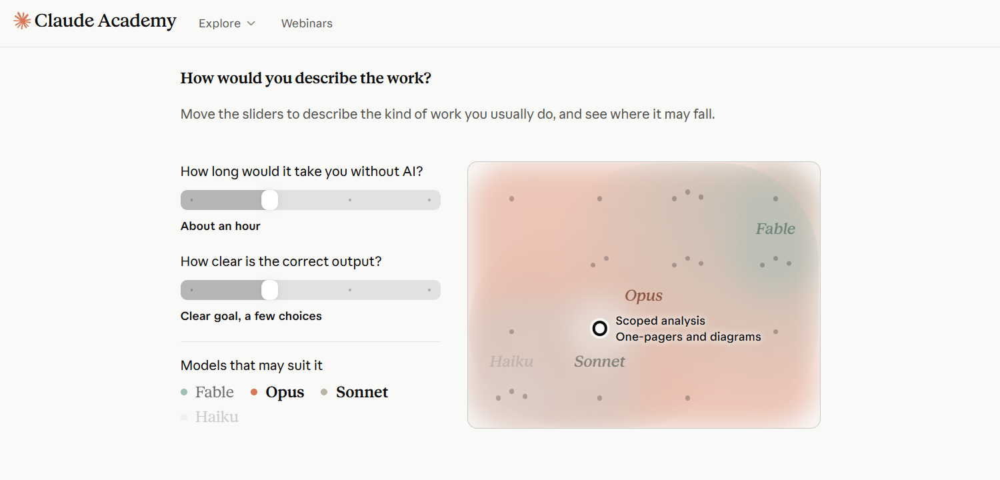
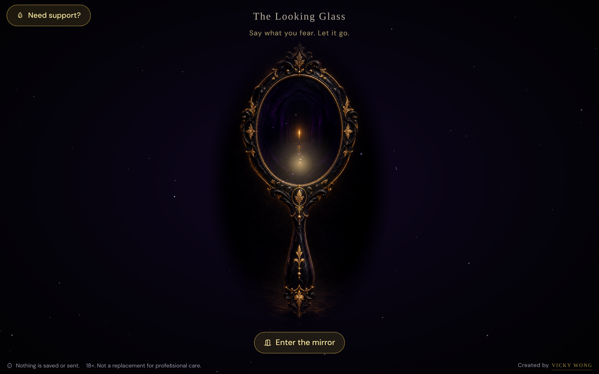
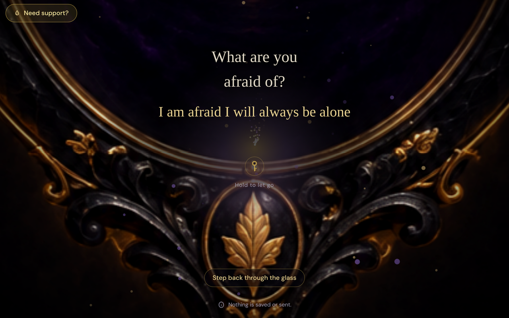
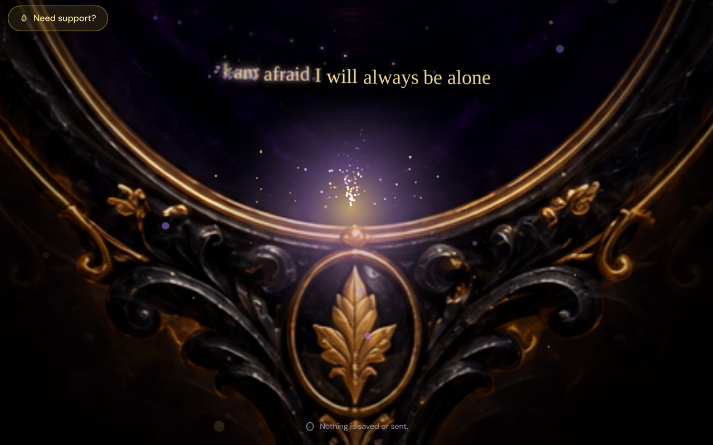

  <h1>🪞 The Looking Glass</h1>

  

    A quiet mirror to what dreamers fear, holding the key while watching it burn away.
  

<h2>📑 Table of Contents</h2>

<ul>
  <li><a href="#objective">Objective</a></li>
  <li><a href="#inspiration">Inspiration</a></li>
  <li><a href="#project-details">Project Details</a></li>
  <li><a href="#experience">Experience</a></li>
  <li><a href="#privacy">Privacy</a></li>
  <li><a href="#app">App</a></li>
  <li><a href="#images">Images</a></li>

</ul>

<h2 id="objective">🎯 Objective</h2>

This project was created for dreamers living in a dream within a dream. Every part emerged from the story of Yennefer of Vengerberg from The Witcher who was deemed worthless, yet carrying raw, unseen power. Like Egwene al'Vere at the end of The Wheel of Time, dreamers leave holding their full power. This browser app is a mirror, not a chat. There is no comfort, no replies, no advice, no pre-written reflections, no pity, and no platitudes. The mirror takes your words and says nothing back. It chooses full power. Created with Lovable, Claude, ChatGPT, and GitHub, this is a circle of imagination.

<h2 id="inspiration">🎬 Inspiration</h2>

<h3>Beginning: Yennefer’s Chaos</h3>

<table>
  <tr>
    <td align="left" valign="middle">
      
       
      <a href="https://youtu.be/6i81DZj7uXE?si=qurQ6fXLw80jrxkG">Watch Video</a>
    </td>
    <td align="center" valign="middle">
      
    </td>
  </tr>
</table>

The beginning belongs to Yennefer, who slaved and broke through her restraints as a sorceress. By letting her chaos explode, she accepted her vulnerable past,   alchemizing it into fiery willpower. Her chaos sets the tone—violet and gold are her colors. Letting go is not a gentle sigh, but a burn: dreamers hold the key until it turns and the words crumble into fire. The dark hall, the single candle at the end of it, and the walk toward that light are the same bargain Yennefer makes: pain first, power after.

<h3>Ending: Egwene’s Light</h3>

<table>
  <tr>
    <td align="left" valign="middle">
      
       
      <a href="https://youtu.be/Drvccpxn9H4?si=590GFECoZsIhQDsk">Watch Video</a>
    </td>
    <td align="center" valign="middle">
      
    </td>
  </tr>
</table>

The ending belongs to Egwene, who was collared and broke through her restraints as a damane. By enduring every pain and punishment along the way, she claimed her power. On the fifth release, the candle is no longer at the far end of the hall, and the light is no longer something to walk toward. It erupts, and it is Egwene’s light.

<h3>The Threshold: Through the Looking-Glass</h3>

The name and the threshold come from Lewis Carroll’s Through the Looking-Glass, where the glass is not a surface, but a passage into somewhere else. Touch it here, and it mists like breath on a cold window; press it, and the hall on the other side opens.

<h2 id="project-details">🛠️ Project Details</h2>

  <strong>Tools:</strong> Lovable, Claude, ChatGPT, Github

  <strong>Workflow:</strong> Claude → Lovable → ChatGPT → Claude & Lovable → Github

  <strong>Models:</strong> Claude Sonnet 4.6 (2026), Claude Sonnet 5.5 (2026), Claude Opus 5 (2026), ChatGPT 6.2 Sol (2026)

  <strong>Format:</strong> Browser app

<table>
  <tr>
    <td align="center" valign="middle">
      
    </td>
  </tr>
</table>

<h2 id="experience">🕯️ Experience</h2>

A small ritual for adults still carrying what childhood handed them. There are no replies, no advice, and no reflections written in advance. Dreamers name one fear, step through the glass, and hold a key until it turns. The words crumble into the flame of a candle at the end of a dark hall. Five releases bring the candle closer. The fifth erupts, and carries the dreamer back out. The mirror answers nothing. It only takes the words, and leaves the light with the dreamer.

<h2 id="privacy">🔒 Privacy</h2>

  What dreamers write is never saved and never leaves their device. There is no
  account, no journal and no history. The site counts anonymous visits only,
  never their words. This is a quiet ritual, not therapy or medical care.
  For ages 18+.

<h2 id="app">📱 App</h2>

  <a href="https://redefiningvicky.github.io/The-Looking-Glass/">
    Enter the Mirror
  </a>

<h2 id="images">🖼️ Images</h2>

<h3>The Ritual</h3>

<table>
  <tr>
    <td>
      
    </td>
  </tr>
</table>

<h3>The Arc</h3>

<table>
  <tr>
    <td>
      
    </td>
  </tr>
</table>

<h3>The Mirror, From Outside</h3>

<table>
  <tr>
    <td>
      
    </td>
  </tr>
</table>

<h3>Name It</h3>

<table>
  <tr>
    <td>
      
    </td>
  </tr>
</table>

<h3>Let It Burn</h3>

<table>
  <tr>
    <td>
      
    </td>
  </tr>
</table>

<h3>The Fifth Release</h3>

<table>
  <tr>
    <td>
      
    </td>
  </tr>
</table>

<h3>Support, Any Hour</h3>

<table>
  <tr>
    <td>
      
    </td>
  </tr>
</table>

  

    <a href="https://github.com/redefiningvicky/redefiningvicky">
      Back to Portfolio
    </a>
  

