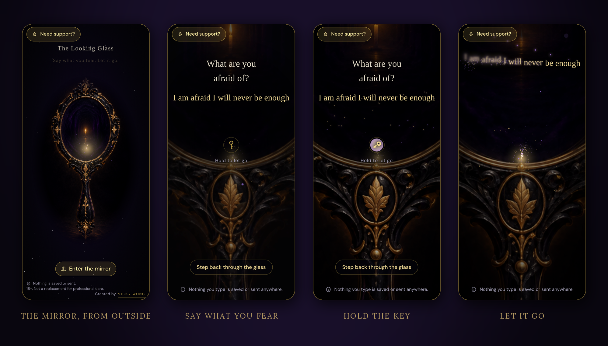
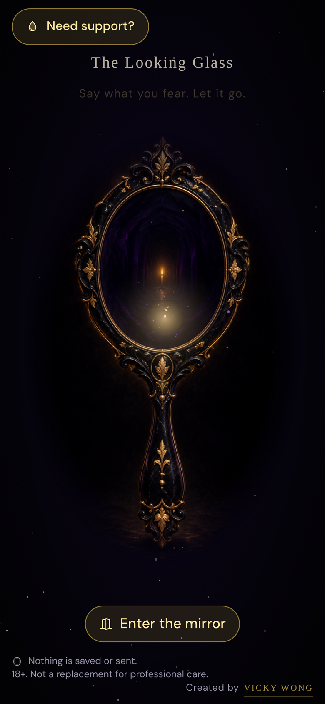
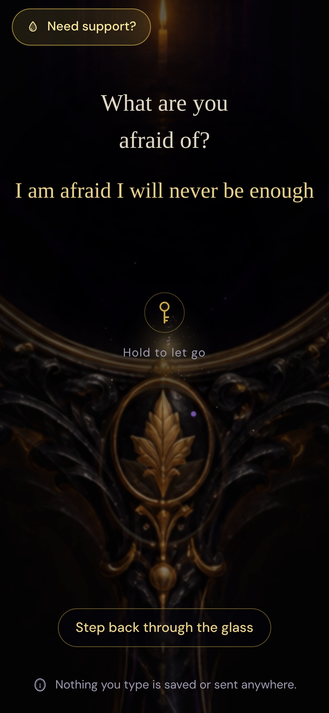
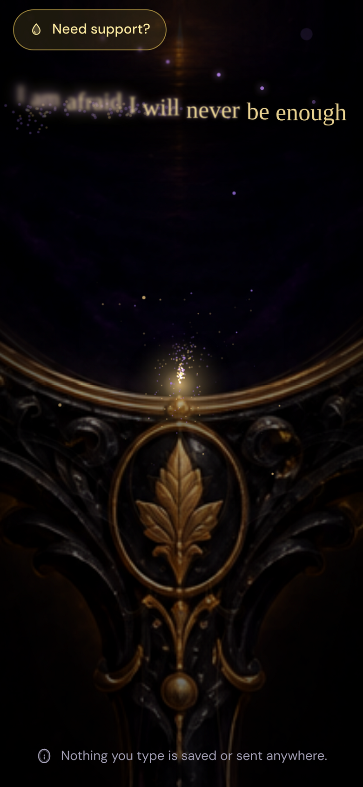
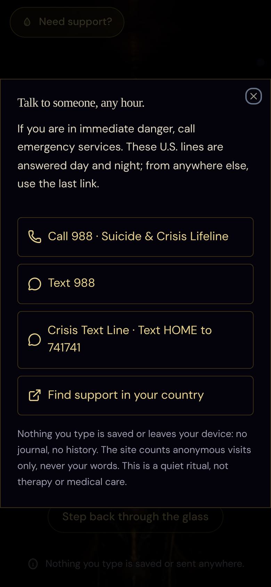

  <h1>🪞 The Looking Glass</h1>

  

    A quiet mirror. Say what you fear, hold the key,
    and watch it burn away. Nothing is saved or sent.
  

<h2>📑 Table of Contents</h2>

<ul>
  <li><a href="#objective">Objective</a></li>
  <li><a href="#inspiration">Inspiration</a></li>
  <li><a href="#project-details">Project Details</a></li>
  <li><a href="#app">App</a></li>
  <li><a href="#privacy">Privacy</a></li>
  <li><a href="#images">Images</a></li>
  <li><a href="#credit">Credit</a></li>
</ul>

<h2 id="objective">🎯 Objective</h2>

  A small ritual for adults still carrying what childhood handed them.
  There are no replies, no advice and no reflections written in advance.
  A person writes one fear into the mirror, steps through the glass,
  holds a key until it turns, and the words crumble into the flame of a
  candle at the end of a dark hall. Five releases bring the candle close,
  and the fifth erupts and carries them back out into golden light.
  The mirror answers nothing. It only takes the words and lets them go.

<h2 id="inspiration">🎬 Inspiration</h2>

<h3>Yennefer of Vengerberg, and taking the power back</h3>

  The feeling the app reaches for belongs to
  <a href="https://www.netflix.com/tudum/videos/yennefer-of-vengerberg-or-the-witcher-s1">Yennefer of Vengerberg</a>:
  a woman who walks out of a childhood that treated her as worthless and
  refuses to carry it any further. Her chaos magic gave the app its colours,
  violet and gold, and gave the release its shape. Letting a fear go is not
  a gentle sigh here. It burns, and the light it leaves behind is yours.

<h3>Through the Looking-Glass</h3>

  The name and the doorway come from Lewis Carroll's
  <a href="https://www.gutenberg.org/ebooks/12">Through the Looking-Glass</a>,
  where the glass is not a surface but a way into somewhere else. Touch it
  here and it mists like cold breath; press it and the room on the far side
  opens.

<h2 id="project-details">🛠️ Project Details</h2>

  <strong>Tools:</strong> Lovable, Claude, Github, Github Pages

  <strong>Workflow:</strong> Lovable → Github → Github Pages

  <strong>Format:</strong> Mobile App, one screen, no scrolling

  <strong>Crisis support:</strong> one tap away from every screen
  (988, Crisis Text Line, and a worldwide helpline finder)

<h2 id="app">📱 App</h2>

  <a href="https://redefiningvicky.github.io/The-Looking-Glass/">
    Enter the Mirror
  </a>

<h2 id="privacy">🔒 Privacy</h2>

  What you write is never saved and never leaves your device. There is no
  account, no journal and no history. The site counts anonymous visits only,
  never your words. This is a quiet ritual, not therapy or medical care.
  For ages 18+.

<h2 id="images">🖼️ Images</h2>

<h3>The Ritual</h3>

<table>
  <tr>
    <td align="center">
      
    </td>
  </tr>
</table>

<h3>The Looking Glass App Showcase</h3>

<table>
  <tr>
    <td>
      
    </td>
  </tr>
</table>

<h3>The Mirror, From Outside</h3>

<table>
  <tr>
    <td>
      
    </td>
  </tr>
</table>

<h3>Say What You Fear</h3>

<table>
  <tr>
    <td>
      
    </td>
  </tr>
</table>

<h3>Let It Go</h3>

<table>
  <tr>
    <td>
      
    </td>
  </tr>
</table>

<h3>Support, Any Hour</h3>

<table>
  <tr>
    <td>
      
    </td>
  </tr>
</table>

<h2 id="credit">✨ Credit</h2>

  Created by
  <a href="https://github.com/redefiningvicky/The-Looking-Glass">Vicky Wong</a>.

  

    <a href="https://github.com/redefiningvicky/redefiningvicky">
      Back to Portfolio
    </a>
  

