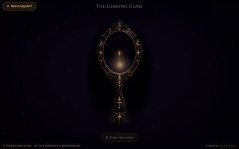
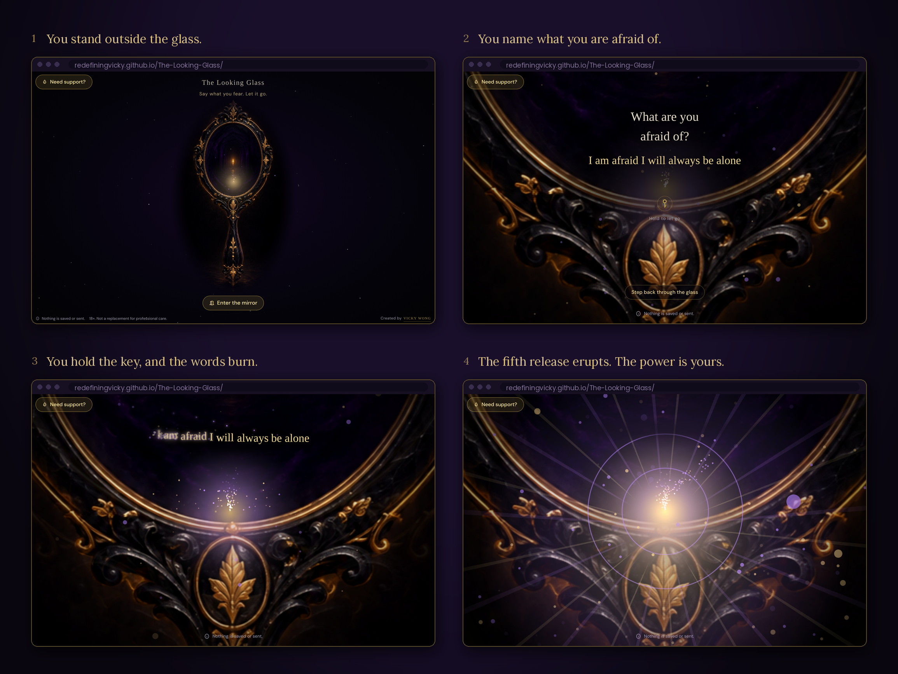
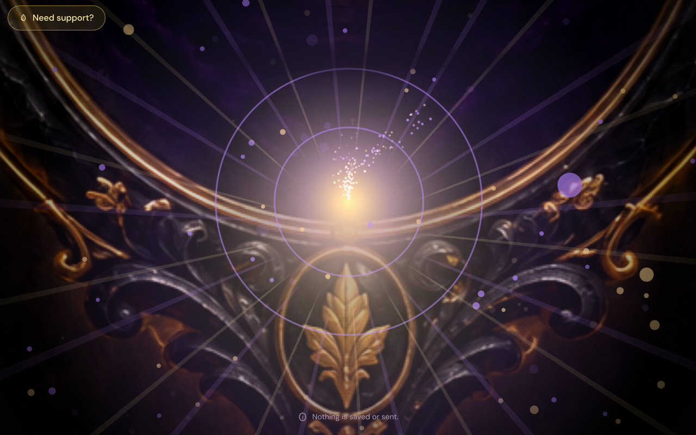
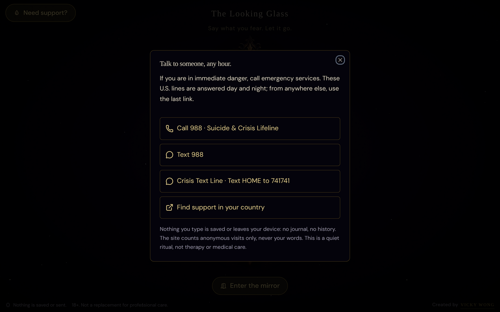

  <h1>🪞 The Looking Glass</h1>

  

    A quiet mirror. Say what you fear, hold the key,
    and watch it burn away. Nothing is saved or sent.
  

<h2>📑 Table of Contents</h2>

<ul>
  <li><a href="#objective">Objective</a></li>
  <li><a href="#inspiration">Inspiration</a></li>
  <li><a href="#project-details">Project Details</a></li>
  <li><a href="#privacy">Privacy</a></li>
  <li><a href="#app">App</a></li>
  <li><a href="#images">Images</a></li>

</ul>

<h2 id="objective">🎯 Objective</h2>

  A small ritual for adults still carrying what childhood handed them.
  There are no replies, no advice and no reflections written in advance.
  You name one fear, step through the glass, and hold a key until it turns.
  The words crumble into the flame of a candle at the end of a dark hall.
  Five releases bring the candle closer, and the fifth erupts and carries
  you back out. The mirror answers nothing. It only takes the words,
  and leaves the light with you.

<h2 id="inspiration">🎬 Inspiration</h2>

<h3>Yennefer of Vengerberg — from the first glass to the last</h3>

  Every part of this app came out of
  <a href="https://www.netflix.com/tudum/videos/yennefer-of-vengerberg-or-the-witcher-s1">Yennefer</a>:
  a woman handed a childhood that treated her as worthless, who refuses to
  carry it any further and makes her own power out of what was done to her.

  That is why the app is a mirror and not a chat. Yennefer is never consoled
  out of her pain, so nothing here offers comfort: no replies, no advice,
  no reflections written in advance, no pity and no platitudes. The mirror
  takes the words and says nothing back.

  Her chaos set the rest. Violet and gold are her colours. Letting go is not
  a gentle sigh but a burn: you hold a key until it turns and the words
  crumble into fire. The dark hall, the single candle at the end of it, and
  the walk toward that light are the same bargain she makes, pain first and
  power after.

<h3>Egwene al'Vere — where the arc lands</h3>

  The ending belongs to
  <a href="https://wot.fandom.com/wiki/Egwene_al%27Vere">Egwene</a>,
  an innkeeper's daughter who is collared and broken as a damane and still
  rises to the Amyrlin Seat, taking every punishment on the way and claiming
  the seat anyway. On the fifth release the candle is no longer at the far
  end of the hall and the light is no longer something to walk toward.
  It erupts, and it is yours. Like Yennefer at the end of her own story,
  you leave holding your full power.

<h3>Through the Looking-Glass — the doorway</h3>

  The name and the threshold come from Lewis Carroll's
  Through the Looking-Glass</a>,
  where the glass is not a surface but a way into somewhere else. Touch it
  here and it mists like breath on a cold window; press it and the hall on
  the other side opens.

<h2 id="project-details">🛠️ Project Details</h2>

  <strong>Tools:</strong> Lovable, Claude, Github, Github Pages

  <strong>Workflow:</strong> Lovable → Github → Github Pages

  <strong>Format:</strong> Browser app, one screen, no scrolling

  <strong>Crisis support:</strong> one tap away from every screen
  (988, Crisis Text Line, and a worldwide helpline finder)

<h2 id="app">📱 App</h2>

  <a href="https://redefiningvicky.github.io/The-Looking-Glass/">
    Enter the Mirror
  </a>

<h2 id="privacy">🔒 Privacy</h2>

  What you write is never saved and never leaves your device. There is no
  account, no journal and no history. The site counts anonymous visits only,
  never your words. This is a quiet ritual, not therapy or medical care.
  For ages 18+.

<h2 id="images">🖼️ Images</h2>

<h3>The Ritual</h3>

<table>
  <tr>
    <td>
      
    </td>
  </tr>
</table>

<h3>The Arc</h3>

<table>
  <tr>
    <td>
      
    </td>
  </tr>
</table>

<h3>The Mirror, From Outside</h3>

<table>
  <tr>
    <td>
      
    </td>
  </tr>
</table>

<h3>Name It</h3>

<table>
  <tr>
    <td>
      
    </td>
  </tr>
</table>

<h3>Let It Burn</h3>

<table>
  <tr>
    <td>
      
    </td>
  </tr>
</table>

<h3>The Fifth Release</h3>

<table>
  <tr>
    <td>
      
    </td>
  </tr>
</table>

<h3>Support, Any Hour</h3>

<table>
  <tr>
    <td>
      
    </td>
  </tr>
</table>

  

    <a href="https://github.com/redefiningvicky/redefiningvicky">
      Back to Portfolio
    </a>
  

